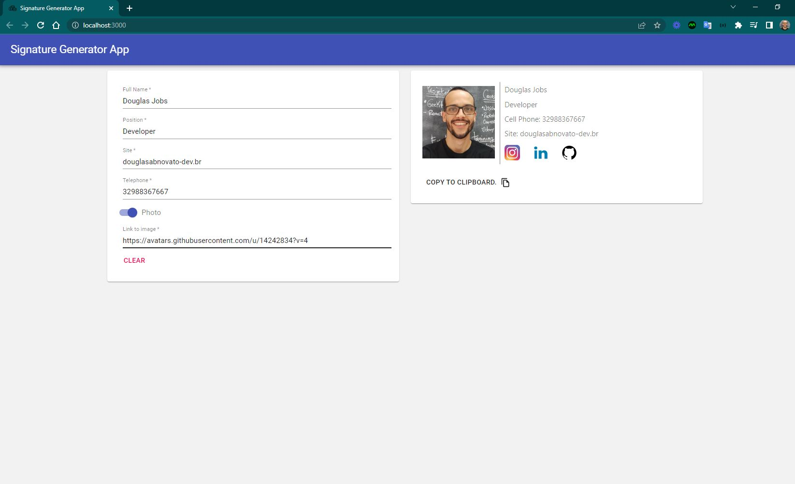

<h4 align="center"> 
	🚧 Digital Identity Suite  🚀
</h4> 

<h1 align="center">
    
</h1>

### 🌐 Em produção

- URL: https://douglasabnovato.github.io/signature-generator/
- Hospedagem: GitHub Pages, publicado pelo GitHub Actions a cada push na `master`
- Passo a passo: [documentacao/DEPLOY.md](documentacao/DEPLOY.md)
- Avaliação e plano: [documentacao/AVALIACAO.md](documentacao/AVALIACAO.md) · [documentacao/PLANO-ESTRATEGICO.md](documentacao/PLANO-ESTRATEGICO.md)

### 💻 Sobre o projeto

♻️ **Digital Identity Suite** é uma evolução profissional do clássico Signature Generator. A aplicação oferece um painel inteligente e responsivo para preenchimento de dados e geração em tempo real de identidades visuais corporativas e pessoais para o mercado digital.

O sistema suporta três grandes vertentes de apresentação profissional:
1. **Assinaturas de E-mail Corporativas:** Tabelas HTML com estilos *inline* para compatibilidade máxima com Gmail, Outlook e Apple Mail.
2. **Crachás Digitais (Digital ID Cards):** Modelos verticais sofisticados de identificação corporativa com dados de ID, departamento e validade.
3. **Cartões de Visita Digitais Mobile:** Formatos voltados para dispositivos móveis com gradientes, avatares em destaque, tags de especialidade e links interativos.
 
#### 🎨 Layout

Uma aplicação web moderna e responsiva desenvolvida em React com TypeScript, integrando Material-UI.

#### 📂 Estrutura de Pastas

```text
SIGNATURE-GENERATOR/
├── .github/
├── build/
├── docs/
├── node_modules/
├── public/
├── src/
│   ├── assets/
│   │   ├── behance.png
│   │   ├── facebook.png
│   │   ├── linkedin.png
│   │   ├── Logo.png
│   │   ├── software-development.png
│   │   ├── steve-jobs.jpg
│   │   └── twitter.png
│   ├── components/
│   │   ├── CircularProgressWithLabel.tsx
│   │   └── Signature.tsx
│   ├── types/
│   │   └── signature.ts
│   ├── utils/
│   │   └── signatureHelpers.ts
│   ├── App.css
│   ├── App.tsx
│   ├── index.css
│   ├── index.tsx
│   └── react-app-env.d.ts
├── .gitignore
├── package-lock.json
├── package.json
├── postcss.config.js
├── README.md
├── tailwind.config.js
└── tsconfig.json
```

# Proposta de Funcionalidades e Arquitetura: Digital Identity Suite v5.0

## 🎯 1. Visão Geral da Funcionalidade Core
A aplicação permite que profissionais criem assinaturas de e-mail limpas, crachás digitais de identificação e cartões de visita móveis interativos em tempo real, oferecendo preenchimento guiado e uma galeria exclusiva de 9 variações de design.

---

## 🚀 2. Funcionalidades Principais (Features)

### A. Painel de Dados do Usuário (Formulário Inteligente)
* **Informações Básicas:** Nome completo, cargo/função, empresa/departamento.
* **Contatos:** E-mail principal, telefone/celular, site da empresa.
* **Redes Sociais Dinâmicas:** Links integrados com ícones automáticos em vetor SVG (LinkedIn, GitHub, Instagram, WhatsApp, YouTube e Twitter/X).
* **Avatar e Personalização:** Inclusão de foto de perfil (via link ou base64) com opção de ativar/desativar o modo com foto.
* **Atributos Específicos:** Suporte a ID de crachá, data de expiração, departamento e tags de especialidades profissionais dinâmicas.

### B. O Ecossistema de 9 Templates Visuais
* **Seletor de Produto Master:** Alternância dinâmica em tempo real entre *Assinatura de E-mail*, *Crachá Digital* e *Cartão de Visita Digital*.
* **Galeria de 9 Designs Exclusivos:** 
  * *Assinaturas:* Classic (divisor vertical), Modern (card destaque) e Minimalist (barra lateral).
  * *Crachás:* Tech Cyber, Corporate Clean e Creative Neon.
  * *Cartões Mobile:* Mobile App, Horizontal Banner e Sleek Dark.

### C. Engine de Pré-visualização Avançada (Live Preview)
* **Split-Screen Responsivo:** Atualização instantânea à medida que o usuário interage com os campos.
* **Alternância de Fundo (Dark / Light Preview):** Botões dedicados para testar o contraste e a legibilidade da identidade visual sob diferentes temas de fundo.

### D. Ações Contextuais e Exportação Otimizada
* **Cópia em HTML Formatado:** Injeção limpa na área de transferência para uso imediato em clientes de e-mail.
* **Exportação Direta em Imagem PNG (Alta Qualidade):** Conversão automatizada via processamento gráfico do DOM (`html-to-image`), permitindo baixar o card estilizado para compartilhamento rápido no WhatsApp, redes sociais ou portfólios.

---

## 📐 Requisitos Técnicos e de Arquitetura

### Requisitos Funcionais (RF)
* **RF01:** O sistema deve validar os campos de e-mail e URLs de redes sociais antes de gerar o código final.
* **RF02:** O layout gerado para e-mails deve utilizar tabelas HTML (`<table>`) aninhadas e estilos *inline* para compatibilidade irrestrita com webmails restritos.
* **RF03:** Arquitetura componentizada em React moderno com TypeScript estrito, garantindo segurança de tipos na gestão do estado global da suíte.

### Requisitos Não Funcionais (RNF)
* **RNF01 (Performance):** Renderização da pré-visualização em tempo real sem latência perceptível.
* **RNF02 (Compatibilidade Visual):** Ícones renderizados por meio de vetores SVG inline, blindando a aplicação contra bloqueios de políticas de CORS em exportações gráficas.
* **RNF03 (Stack Moderna):** Integração com Material-UI (v7) e bibliotecas de manipulação de imagem de alta performance.

---

#### Web - v5.1 (revisão de qualidade)
- [x] Voltou a compilar: a foto padrão (`src/assets/steve-jobs.jpg`) não estava no repositório; agora o avatar é gerado com as iniciais
- [x] Links da assinatura saneados (só http/https; `javascript:` era copiado para o e-mail)
- [x] Cópia com a API de área de transferência (HTML + texto) e aviso quando falha
- [x] Material UI 4 → 7, React 17 → 18, CRA 4 → Vite 8; Tailwind (sem uso) removido
- [x] WCAG AA na aplicação (axe-core sem violações); 5 testes automatizados
- Detalhes em [documentacao/](documentacao/ANALISE.md)

#### Web - v5.0
- Evolução completa para a **Digital Identity Suite**: Suporte a 3 produtos distintos (Assinatura, Crachá e Cartão Digital), totalizando 9 templates visuais exclusivos, alternador de fundo para preview, ícones em SVG inline e exportação automatizada em formato de imagem PNG.

#### Web - v3.1
- Revisando o design do projeto e identificando pontos de melhorias.
- **Próximo passo:**
  * [x] Hospedar aplicação
  * [ ] Design nas transições
  * [x] Eficiência da assinatura
  * [x] Limpar design

#### Web - v3.0
- Implementar as funcionalidades descritivas no projects board com as issues e fazer a atualização na master das branches com pull requests.

#### Web - v2.0
- Avançado design para uma estilização mais moderna.

#### Web - v1.0
- Um layout simples, preto e branco.

---

### 🛠 Tecnologias
As seguintes ferramentas foram usadas na construção do projeto:
* SPA (Single Page Application)
* HTML5 / CSS3 / JavaScript
* Material UI (v7)
* Vite 8 e Vitest
* TypeScript
* html-to-image
* Node.js
* React
* Git
* Github

#### Pré-requisitos
Antes de começar, você vai precisar ter instalado em sua máquina as seguintes ferramentas: **Git** e **Node.js**. 
Além disto, é bom ter um editor para trabalhar com o código como o **VSCode**.

### 🧭 Rodando a aplicação web

```bash
git clone https://github.com/douglasabnovato/signature-generator
cd signature-generator
npm install
npm run dev       # http://localhost:5173
npm test          # testes com Vitest
npm run build     # gera build/ (a publicação é feita pelo GitHub Actions)
npm run deploy    # alternativa manual: publica build/ na branch gh-pages
```

#### 😯 Como contribuir para o projeto

1. Faça um **fork** do projeto.
2. Crie uma nova branch com as suas alterações: `git checkout -b my-feature`
3. Salve as alterações e crie uma mensagem de commit contando o que você fez: `git commit -m "feature: My new feature"`
4. Envie as suas alterações: `git push origin my-feature`
> Caso tenha alguma dúvida confira este [guia de como contribuir no GitHub](https://github.com/firstcontributions/first-contributions)

#### 📝 Licença

Este projeto está sob a licença MIT.

---

Feito com ❤️ por <a href="https://www.linkedin.com/in/douglasabnovato/"></a>👋🏽

## Próximos passos do responsável

- Testar a assinatura gerada em um e-mail real.
- Criar uma conta gratuita no [GoatCounter](https://www.goatcounter.com/) e definir `VITE_GOATCOUNTER_CODE` no ambiente de build, com o código da conta. Sem isso, os eventos não são enviados.

Acompanhamento nas issues #66 e #87.
