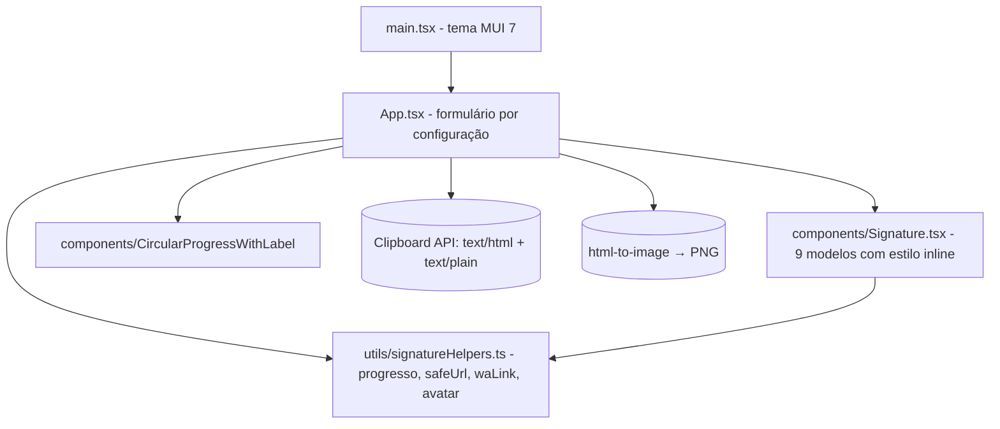

# Arquitetura — Digital Identity Suite

## ADRs

| # | Decisão | Motivo | Alternativa |
|---|---|---|---|
| ADR-01 | Estilos inline nos modelos | Clientes de e-mail ignoram CSS externo | Classes CSS |
| ADR-02 | Saneamento de URL na renderização | Um ponto de controle para prévia, cópia e PNG | Validar só no formulário |
| ADR-03 | Avatar SVG por iniciais | Sem foto de terceiros, sem arquivo externo | Imagem genérica em assets |
| ADR-04 | Documentação do ciclo em `documentacao/` | `docs/` contém um build antigo do GitHub Pages | Sobrescrever docs/ |
